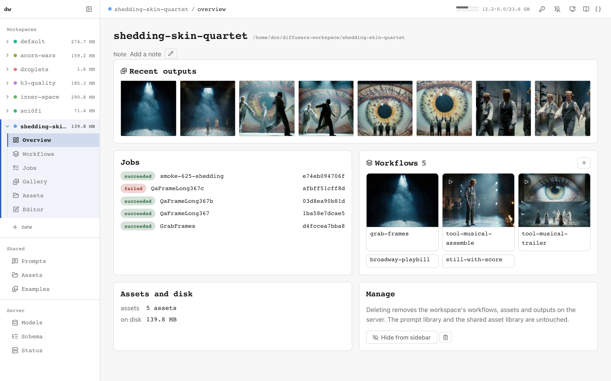
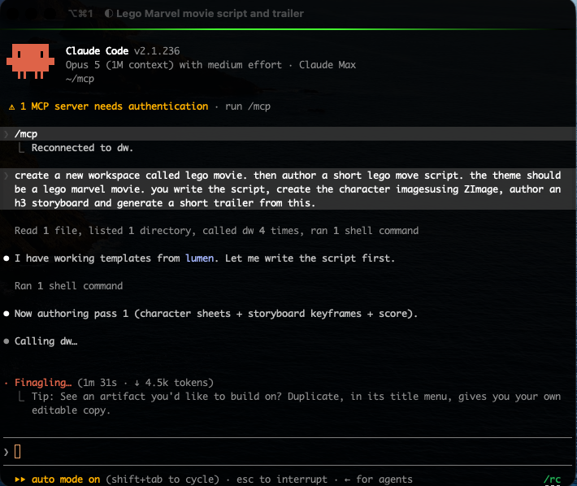
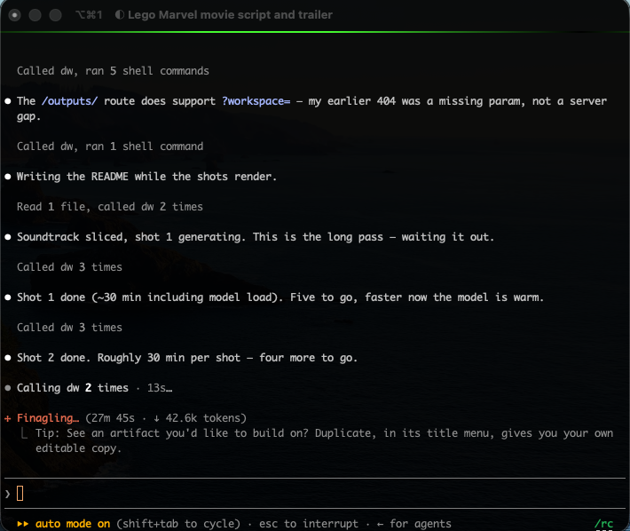
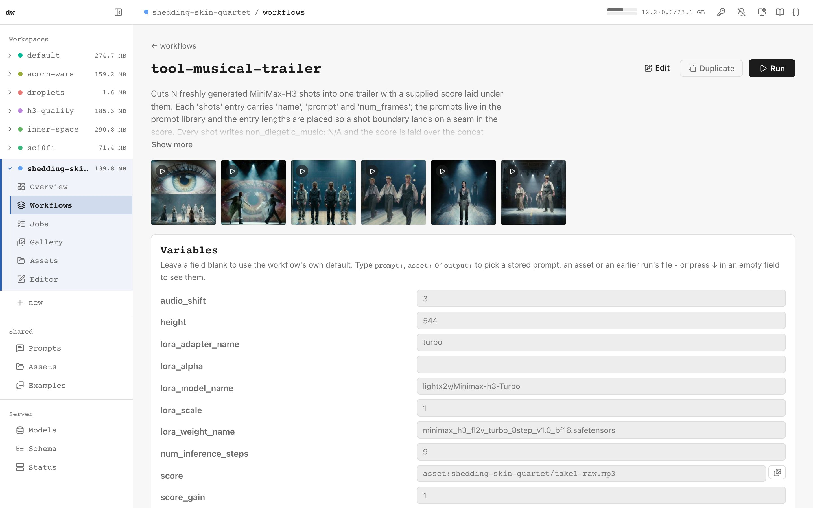
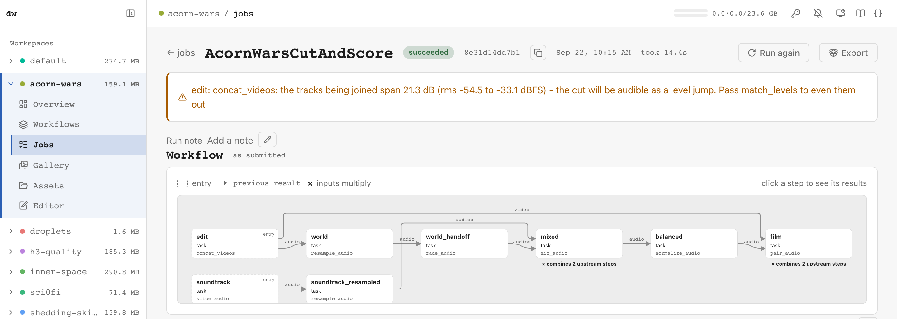
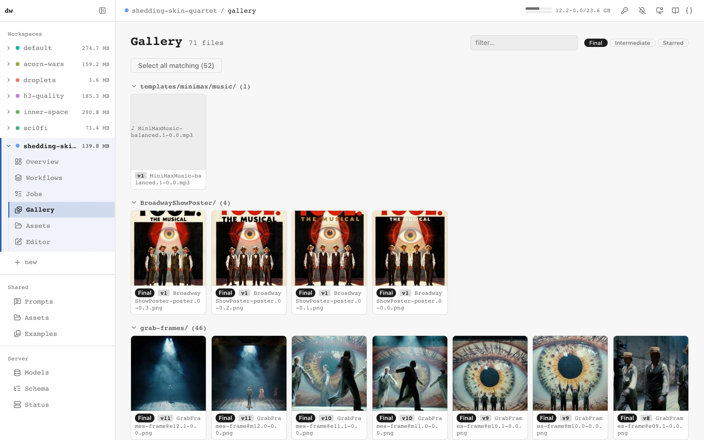
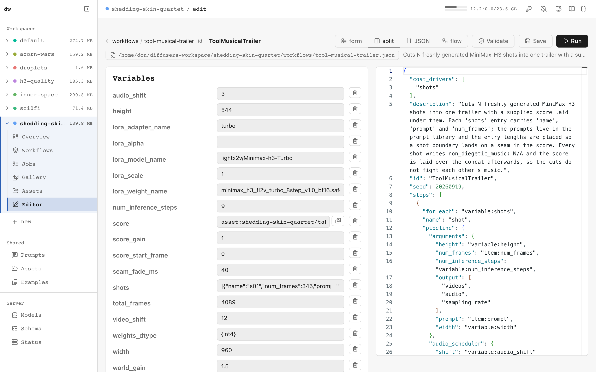
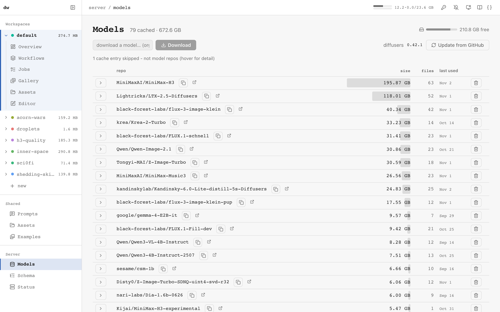

[](https://github.com/dkackman/diffusers-workflow/actions/workflows/github-code-scanning/codeql)

# diffusers-workflow

Your GPU, as something an agent can drive.

diffusers-workflow runs [Hugging Face Diffusers](https://github.com/huggingface/diffusers)
image, video and audio generation as jobs on your own GPU. **An agent does the work.**
Claude Code, or any MCP client, picks or writes the workflow, checks what it will
cost, runs it, and looks at what came back. **You steer from the browser.** Every
workflow, run and output the agent made is in the web UI, where you can change a
variable, run it again, compare takes and keep the one you like.

**Python 3.12-3.14 | CUDA (NVIDIA) | MPS (Apple Silicon) | CPU**

<picture>
  <source media="(prefers-color-scheme: dark)" srcset="docs/img/ui-overview-dark.jpg">
  
</picture>

## Getting started

**1. Install.** The script picks the right torch build for your platform, creates a
virtual environment and installs everything, MCP server included.

```bash
bash ./install.sh && source ./activate      # Linux / macOS
.\install.ps1; .\venv\scripts\activate      # Windows
```

**2. Start the engine.** Leave it running; the agent and the browser both talk to it.

```bash
dw-serve        # web UI on http://127.0.0.1:8765
```

**3. Connect your agent.** Register the MCP server with the absolute path to `dw-mcp`
in the venv you just made (a relative path is the setup detail that most often goes
wrong). Then add the [dw plugin](plugins/dw/README.md):

```bash
claude mcp add dw -- "$(pwd)/venv/bin/dw-mcp"
```

```
/plugin marketplace add dkackman/diffusers-workflow
/plugin install dw@diffusers-workflow
```

Most of the shipped models (Flux, LTX, MiniMax, ...) are **gated**. Request access on
the model's Hugging Face page and run `hf auth login` once. Without it a run fails
partway through with a 401/403 from the Hub. `templates/text-to-image` uses a small,
ungated model, so it makes a good first run.

<details>
<summary><b>GPU on another machine, or in Docker?</b></summary>

Start the engine on the GPU box with `--mcp` and connect over HTTP. There is nothing
to install on the laptop:

```bash
# on the GPU box
dw-serve --host 0.0.0.0 --token "$DW_API_TOKEN" --mcp --workspace ~/studio

# on your laptop
claude mcp add --transport http dw http://gpu-box:8765/mcp \
  --header "Authorization: Bearer $DW_API_TOKEN"
```

The server's **Status** page writes that line for you. The whole setup is in
[Remote GPU server](docs/REMOTE.md).

On Linux with an NVIDIA GPU, the
[`dkackman/diffusers-workflow`](https://hub.docker.com/r/dkackman/diffusers-workflow)
image runs the server with torch, the engine and the web UI built in. It shares the
model cache and workspace with a native install on the same box. See
[Docker](docs/DOCKER.md).

</details>

## Ask the agent

Describe what you want. The agent has 65 tools covering the workflow catalog, the
real diffusers pipeline signatures, the job queue, the gallery and the model cache,
and it stays with a long render until it finishes:



A session sounds like this:

- **"Make a 30-second musical trailer: four men in boater hats, a giant eye, a
  score under it."** The agent picks a shape from the catalog (`list_workflows`),
  breaks the brief into shots, writes each prompt to the prompt library, and builds
  the workflow that renders the shots and cuts them to the score.
- **"What will that cost?"** `validate_workflow` checks the JSON against the schema
  *and* the real pipeline signatures, with no model loads, and quotes an estimate in
  GPU minutes from this box's own history. Anything that spends GPU time or disk
  refuses to run until the agent passes `acknowledged_cost`, so it has to tell you
  what it is about to spend first.
- **"How's it going?"** `wait_for_job` waits out a render without polling. Then
  `get_output_frames`, `get_output_image` and `get_output_audio` bring the result
  back into the conversation, so the agent judges what it made against what you
  asked for.
- **"Shot three is the one. Keep it and start the next scene from it."**
  `keep_output` turns the file into a named asset, and the next workflow references
  it as `asset:hero-frame.png`.

The [dw plugin](plugins/dw/README.md) adds what a general-purpose agent can't know
on its own: one skill per model family (MiniMax H3 and Music 3, LTX-2.5, Kandinsky 6,
FLUX 3 Klein) that picks the template for a request and states the rules that bite.
Cross-cutting skills cover script-to-video, series with a consistent cast,
storyboards and animatics, and a shared camera-and-look vocabulary.



One server holds several **workspaces**, each with its own workflows, assets and
outputs. Two agents, or an agent and you in the browser, can share one GPU without
saving over each other's work.

The tool reference, setup for other MCP hosts and the troubleshooting table are in
[MCP Server](docs/MCP.md).

## Then tweak it in the browser

The web UI shows everything the agent made and lets you take over at any point. It
runs on the same persistent GPU worker, so models stay loaded between runs.

**A workflow the agent wrote is a form you can edit.** The workflow's description,
recent outputs and variables are on one page. Change a prompt, a frame count or a
LoRA scale and press **Run**.



**Every job is a recipe.** A job keeps the exact workflow it ran and draws it as a
graph of how data flows between steps. Click a step to see what it produced. The
run's warnings sit above the graph, so a problem the agent missed, such as an
audible level jump at a cut, is in front of you with the argument that fixes it.
**Run again** repeats the job, and **New seed** gives you another take. Progress
streams live for each denoising step, and a cancel stops the job cleanly at the
next step.



**The gallery** groups outputs by the workflow that made them, with final and
intermediate files kept apart. Any image reopens as the workflow that produced it.
*Keep as asset* adds a file to the asset library for later workflows to use.

<picture>
  <source media="(prefers-color-scheme: dark)" srcset="docs/img/ui-gallery-dark.jpg">
  
</picture>

**The editor works on the agent's JSON.** You can view the workflow as a form, as
JSON, side by side, or as a flow graph. The forms and autocomplete come from the
real diffusers pipeline signatures, so every argument a pipeline takes is there with
its documentation. **Validate** catches schema errors and argument typos before any
model loads.



There is also a **prompt library**, with an *Enhance with AI* panel that expands an
idea into a full prompt using a local language model. The **model manager** shows
the Hugging Face cache (size, last use, free disk) and downloads or deletes models
with live progress.



The pages are described in [Server & Web UI](docs/SERVER.md). The UI and the agent
both use the server's HTTP API, which you can browse at `/docs` on a running server
(see [The HTTP API](docs/SERVER.md#the-http-api)).

## Underneath

Every front end reads and writes the same thing: a JSON workflow of named steps,
each a diffusers pipeline or a utility task. Its arguments are references to
variables, earlier steps' results, stored prompts and assets, not hard-coded
values. That is how text-to-image chains into image-to-video, and how a generated
image reopens as the recipe that made it. You rarely need to write one by hand. When
you do, the [Workflow Guide](docs/WORKFLOW_GUIDE.md) is the reference, the
[JSON Schema](dw/workflow_schema.json) is the exact structure, and
[workflows/](workflows/) has runnable examples for each model family. There is also
a command-line client, `python -m dw.run workflow.json prompt="a cat"`, which queues
a job on a running server (see [Server & Web UI](docs/SERVER.md#the-command-line)).

The engine also covers:

- **Quantization:** BitsAndBytes, TorchAO, GGUF, SDNQ and optimum-quanto, set per
  component.
- **Acceleration:** FirstBlockCache, FasterCache, MagCache, TaylorSeerCache,
  `torch.compile` and attention backends.
- **Adapters and prompts:** LoRA, IP-Adapter and A1111-style prompt weighting.
- **Long video and caching:** long-video chaining with audio-driven length, and
  step-output caching, so re-running a fixed-seed workflow finishes instantly.
- **Utility tasks:** upscaling, face restoration, segmentation, captioning, frame
  interpolation, audio slicing, cut-and-score assembly and more.

A workflow can reach any diffusers pipeline or quantization backend by dynamic
import, so loading one can execute arbitrary Python. Treat a workflow file from
someone else the way you'd treat a `.py` script. See
[Trust model](docs/SECURITY.md#trust-model).

**Field reports.** At the end of a session, ask the agent what got in its way, and
have it file each bug or gap as an issue on `dkackman/diffusers-workflow` with the
`field-report` label. The label marks a report as coming from real use. A report
from anyone but the maintainer is reviewed before the [agent loop](docs/AGENT_LOOP.md)
acts on it.

## Documentation

**Using it**

- [MCP Server](docs/MCP.md) - the agent's tool surface (Claude Code, Claude Desktop, other MCP hosts)
- [dw plugin](plugins/dw/README.md) - the model-family and composition skills
- [Server & Web UI](docs/SERVER.md) - the web UI, the command line, and the [HTTP API](docs/SERVER.md#the-http-api) with its OpenAPI spec
- [Workspaces](docs/WORKSPACES.md) - where your content lives, run directories, several workspaces on one server
- [Remote GPU server](docs/REMOTE.md) - the server, UI and MCP from another machine
- [Docker](docs/DOCKER.md) - the server in a container on a Linux NVIDIA box

**Workflows in depth**

- [Workflow Guide](docs/WORKFLOW_GUIDE.md) - JSON structure, variables, steps, data flow, references
- [Tasks](docs/TASKS.md) - image, video and audio utility tasks, ControlNet preprocessors
- [Quantization](docs/QUANTIZATION.md) - BitsAndBytes, TorchAO, GGUF, SDNQ
- [Inference Acceleration](docs/ACCELERATION.md) - caches, `torch.compile`, attention backends, MPS
- [Fast on 24GB](docs/RECIPES_24GB.md) - tested speed/memory settings per model family
- [LoRA](docs/LORAS.md), [IP-Adapter](docs/IP_ADAPTER.md), [Prompt Weighting](docs/PROMPT_WEIGHTING.md)

**Reference**

- [Architecture](docs/ARCHITECTURE.md) - each concept, the module that owns it, and the check that enforces it
- [Worker Guide](docs/WORKER_GUIDE.md) - the persistent GPU worker and troubleshooting
- [Security](docs/SECURITY.md) - validators and the trust gate ([quick reference](docs/SECURITY_QUICKREF.md))
- [Dependencies](docs/DEPENDENCIES.md), [Testing](docs/TESTING.md), [Releasing](docs/RELEASING.md)
- [Agent Loop](docs/AGENT_LOOP.md) - what the automated implementer/tester labels mean
- [Attributions](docs/ATTRIBUTIONS.md) - code from other projects, and the projects whose ideas dw reimplemented
