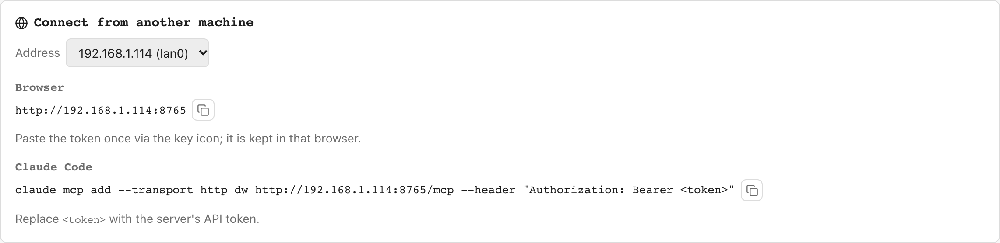

# Using dw from another machine

`dw.serve` runs on the machine with the GPU; a browser and Claude Code on
your laptop use it over the network. Nothing is installed on the laptop.

## On the GPU box

1. Install as usual (`git clone …`, `bash ./install.sh`), or run the
   container ([DOCKER.md](DOCKER.md), with `DW_BIND=0.0.0.0`), which makes
   the token for you; then skip to the clients.
2. Make a token: `openssl rand -hex 32`. It is the only thing between "on
   your network" and "can run workflows on your GPU".
3. Run it bound to the network, with the token, with MCP:

       DW_API_TOKEN=<token> dw-serve --host 0.0.0.0 --mcp

   `--mcp` on a non-loopback bind with no token is refused (exit 2): an MCP
   endpoint can author and run workflows and has no token-entry page in
   front of it. Without `--mcp`, a non-loopback bind with no token only logs
   a warning.

   To keep it running across logouts and reboots, use the systemd unit in
   [contrib/systemd](../contrib/systemd/README.md).
4. Open port 8765 in the box's firewall for your LAN only (for example
   `sudo ufw allow from 192.168.1.0/24 to any port 8765`).

Never pass `--trust-workflows` on a server other machines can reach: it lets
any workflow, including one an agent wrote, execute arbitrary Python. See
[SECURITY.md](SECURITY.md#trust-model).

Check it from the laptop:

    curl http://<box>:8765/api/health -H "Authorization: Bearer <token>"
    {"status":"ok","version":"…","hostname":"gpu-box","device":"cuda","mcp":true,…}

`hostname` and `device` say which machine answered.

### URLs handed to a person

`export_job`, `list_gallery` and the upload and asset routes return paths
relative to the server (`/exports/job-1.zip`): right for a browser already
pointed at the box, useless to someone who is not. Set `DW_PUBLIC_URL` (or
the `public_url` setting) to the server's origin and those responses add
`absolute_url` / `absolute_zip_url` built from it:

    DW_API_TOKEN=<token> DW_PUBLIC_URL=https://dw.example.com dw-serve --host 0.0.0.0 --mcp

Nothing guesses the origin from request headers, so an unconfigured server
omits the field. The export zip, like `/outputs` and `/inputs`, needs no
token (#592), so an agent with HTTP fetches `export_job`'s `open_url`
itself, prefixing a relative one with the address it reaches the server at.

## Browser

Open `http://<box>:8765`. Click the key icon in the header and paste the
token once; it is kept in the browser's `localStorage` and sent with every
request. The Server → Status page shows the server's addresses and the
`claude mcp add` line below, ready to copy.

<picture>
  <source media="(prefers-color-scheme: dark)" srcset="img/ui-connect-dark.png">
  
</picture>

## Claude Code, no local install

    claude mcp add --transport http dw http://<box>:8765/mcp \
      --header "Authorization: Bearer <token>"

Start a new Claude Code session; `/mcp` should list `dw` as connected. Add
`-s user` to have it in every project.

`/mcp` and `/mcp/` are both answered, and both take the token only as an
`Authorization: Bearer` header; the `?token=` allowance a few browser GET
routes have does not extend to `/mcp`.

What differs from the local stdio setup:

- `download_output` writes on the GPU box, where the MCP server runs, so an
  omitted destination is refused rather than dropped in the workspace root
  where nothing on your laptop would find it (#353). Pass an explicit
  destination inside the workspace, use `get_output_image` /
  `get_output_text` to see a result, or open
  `http://<box>:8765/outputs/<name>` in the browser.
- Each tool call is a plain HTTP request; there is no subprocess to restart.
- The mounted MCP server is one client shared by every agent connected to
  the box, so `use_workspace` (or `create_workspace(use=true)`) moves the
  workspace for all of them (#298). When two agents share a box, pass
  `workspace=` on each call that takes it (`validate_workflow`,
  `run_workflow`, most read and media tools) instead of relying on the
  session pin.

## Claude Code with a local install (stdio)

If the laptop also has `dw` installed, the stdio server works against a
remote box too:

    claude mcp add dw -- /path/to/venv/bin/dw-mcp \
      --url http://<box>:8765 --token <token>

`dw-mcp` refuses to start (exit 2) against a non-loopback URL without a
token. At startup it makes one `GET /api/health`, so a wrong URL or token is
reported once instead of as a 401 on every tool call: against a remote URL a
failed probe is fatal, against a loopback URL it only warns (the server may
not be up yet). `--no-probe` skips it.

## Beyond your LAN

Everything above is plaintext HTTP: the token and every prompt and result
are readable on the network path. **Do not port-forward 8765 on your
router.** Two ways to reach the box from outside:

**Tailscale (or another WireGuard overlay)**, the recommended option. Install
it on the box and the laptop and use the box's Tailscale IP or MagicDNS name
in every URL above. Traffic is encrypted end to end with no certificates to
manage, and `dw-serve` can bind to the Tailscale interface
(`--host 100.x.y.z`) rather than `0.0.0.0`.

**A TLS-terminating reverse proxy.** Bind `dw-serve` to loopback and put
Caddy in front of it with a real hostname:

    # /etc/caddy/Caddyfile
    dw.example.com {
        reverse_proxy 127.0.0.1:8765
    }

Caddy obtains and renews the certificate. Use `https://dw.example.com` (no
port) in every URL above. The Origin and Host checks work unchanged because
Caddy forwards `Host` as-is; nginx works the same way with `proxy_pass`,
`proxy_set_header Host $host;` and your own certificate.

Either way the token is still the only authentication: a proxy or a VPN
protects the transport, not the door. A token holder can do anything the API
does, including deleting outputs, models and dw's disk caches.

## What is not here

- TLS inside `dw-serve` itself: a reverse proxy does it better.
- More than one token, or users: one shared secret, deliberately
  ([SERVER.md](SERVER.md#authentication)).
