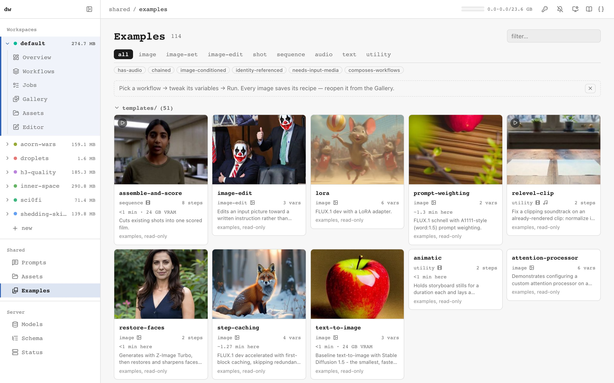
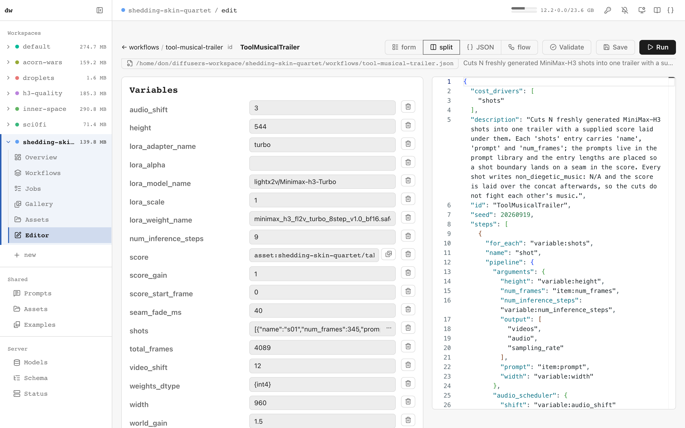
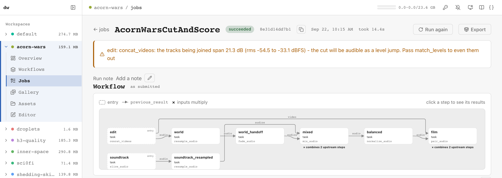
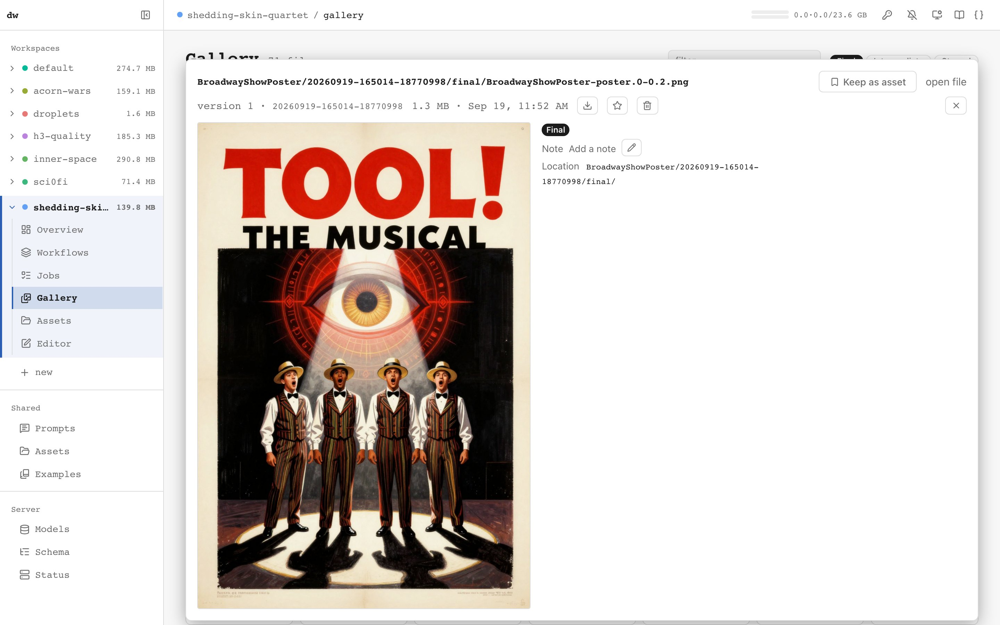
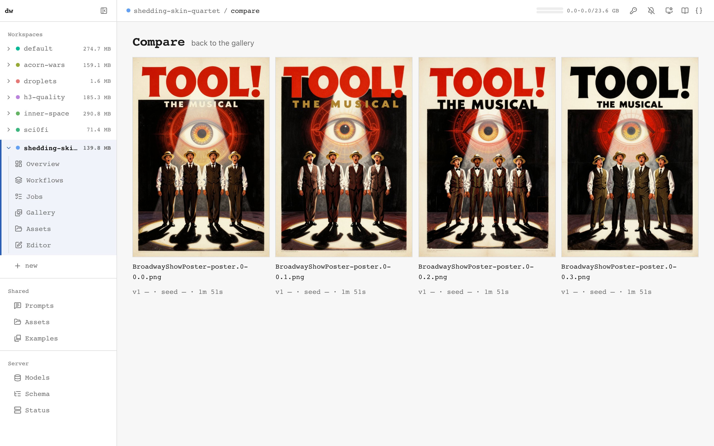
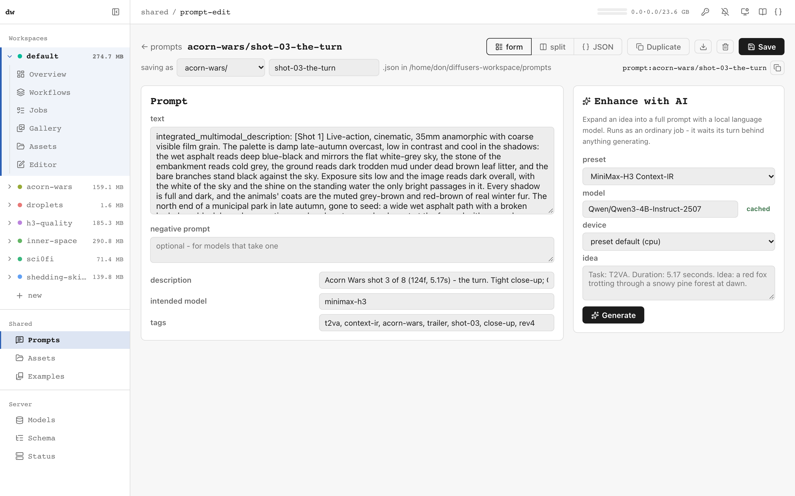
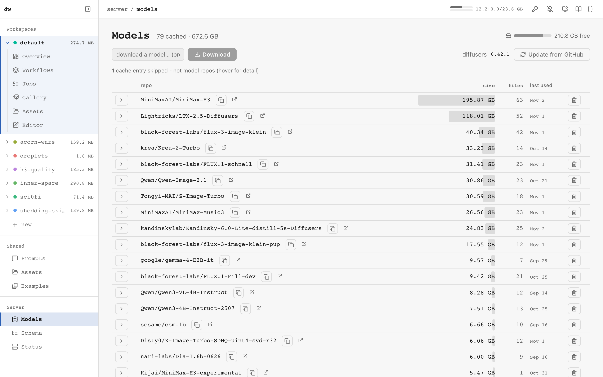
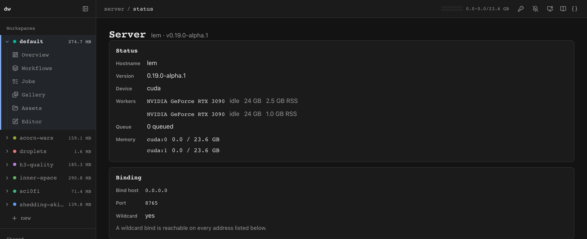
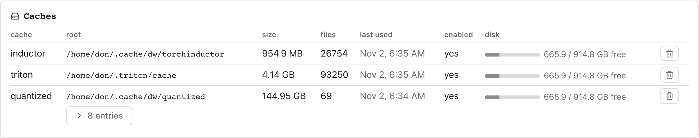

# Server & Web UI

`dw.serve` runs the workflow engine as an HTTP server with a web UI: browse
and run workflows, edit them in a form-based editor driven by the live
pipeline signatures, watch jobs stream progress, review and compare outputs,
manage input assets and the models on disk.

```bash
python -m dw.serve                       # http://127.0.0.1:8765
python -m dw.serve --port 8000 --workflow-dir ./workflows --output-dir ./outputs --prompt-dir ./prompts --asset-dir ./assets

# or point it at a workspace, which supplies all four directories
python -m dw.serve --workspace ~/studio

# your own workflows, with a checkout's examples alongside them read-only
python -m dw.serve --workspace ~/studio --examples-dir ~/src/diffusers-workflow/workflows
python -m dw.serve --host 0.0.0.0 --token "some-long-random-string"   # reachable off this machine
python -m dw.serve --host 0.0.0.0 --token "..." --mcp   # ...and drivable by an agent on another machine
python -m dw.serve --devices cuda:1      # run the worker on the second card
python -m dw.serve --devices cuda:0,cuda:1   # one worker per card, two jobs at once
python -m dw.serve --trust-workflows      # only if nothing untrusted can reach POST /api/jobs - see Security model
```

Installed as a package, the same server is `dw-serve`. The other flags are
`--output-layout {run,flat}` ([WORKSPACES.md](WORKSPACES.md#runs)) and
`-l/--log_level`; `--help` gives each flag's default. Which directories a
server uses, and in what order they are resolved, is in
[WORKSPACES.md](WORKSPACES.md). Running it for other machines is
[REMOTE.md](REMOTE.md); in a container, [DOCKER.md](DOCKER.md).

### The HTTP API

Everything the web UI and the MCP server do goes through one HTTP API, and a
running server describes it:

| Path | What it is |
| ---- | ---------- |
| `/docs` | Swagger UI: every route, its parameters and response, with *Try it out* |
| `/redoc` | The same document in ReDoc, for reading |
| `/openapi.json` | The OpenAPI document itself |

The same document is committed as
[`ui/src/lib/generated/openapi.json`](../ui/src/lib/generated/openapi.json)
for client generation or reading without a server. It is generated, not
written: `scripts/dump_openapi.py` writes it from the server, CI fails when
the committed copy is stale, and its `info.version` is fixed at `"0"` so it
is the same on every machine. GitHub shows it as plain JSON; to browse it,
use `/docs` on a running server. Neither document declares the bearer token;
see [Authentication](#authentication). The sections below cover the
[Jobs API](#jobs-api), the [Introspection API](#introspection-api) and
[Files and models](#files-and-models) in prose.

Each job runs in a persistent GPU worker ([WORKER_GUIDE.md](WORKER_GUIDE.md)):
models stay loaded between runs, so re-running a workflow with a new prompt
skips the load.

### The command line

`dw.run` is a thin client of `dw.serve`: it queues a job over HTTP, prints
its progress, and reports the run directory the server wrote to - start the
server first.

```bash
python -m dw.run workflows/templates/text-to-image.json
python -m dw.run workflows/templates/text-to-image.json prompt="a cat" num_images_per_prompt=4
python -m dw.validate workflows/models/flux-dev.json
```

`dw.run` takes `WORKFLOW [name=value ...] [--server URL] [--workspace NAME]
[--token TOKEN]` - `--server` defaults to `DW_MCP_URL`, else
`http://127.0.0.1:8765`; `--token` to `DW_API_TOKEN`. Where the output lands,
which workspace's `prompts:`/`asset:` references resolve, and the output
layout are all `dw.serve` flags (`--workspace`, `--output-dir`,
`--prompt-dir`, `--asset-dir`, `--output-layout` on the server) - `dw.run`
only says which server and which of its workspaces to run in.

`python -m dw.test` runs a small built-in workflow end to end - it downloads
SD 1.5 (a few GB) and generates one image on whichever accelerator was found.

### Environment

The server reads these from its environment (e.g. `.env`) and its workers inherit them; changing one needs a restart.

| Variable | Default | Effect |
| -------- | ------- | ------ |
| `DW_API_TOKEN` | none | The bearer token, when `--token` is not given ([Authentication](#authentication)) |
| `DW_WORKSPACE`, `DW_PROMPT_DIR`, `DW_OUTPUT_LAYOUT` | unset | The workspace, prompt library and output layout when no flag names them ([WORKSPACES.md](WORKSPACES.md)) |
| `DW_PUBLIC_URL` | unset | The origin absolute URLs in responses are built from ([REMOTE.md](REMOTE.md#urls-handed-to-a-person)) |
| `DW_QUANTIZED_CACHE` | off | `1` caches SDNQ on-the-fly-quantized components on disk, so a later cold load skips the quantize. Anything else is off. See [QUANTIZATION.md](QUANTIZATION.md#cached-on-the-fly-dw_quantized_cache) |
| `DW_QUANTIZED_CACHE_DIR` | `<HF_HOME>/dw-quantized` | Where the cache lives; resolved to an absolute path at start and pinned for the workers |

### Choosing the card

`--devices cuda:1` runs the worker on that card, pinned with
`CUDA_VISIBLE_DEVICES` (and `DW_DEVICE=cuda`), so inside the worker it is the
only card visible. A bare `cuda`, or no flag, pins nothing. The `devices`
setting is the standing form of the flag; the flag wins. A list
(`--devices cuda:0,cuda:1`) runs one worker per card, each running one job at
a time. Refused at startup: a card named twice, a bare `cuda` in a list, and
a single card the machine lacks or a list none of whose cards is present -
the message names the cards that are (`cuda:0 (NVIDIA GeForce RTX 4090)`,
...). A list entry the machine lacks is otherwise dropped with a warning
naming it, and the server starts on the rest.

Each job's record carries `device`, the card it ran on as the server
addresses it (`"cuda:1 NVIDIA GeForce RTX 3090"`): set when the job starts,
null while queued and for jobs recorded before the field existed. Observed
cost figures are bucketed by it: only runs from cards of the same name as
the one the server runs on now count, so a 3090's runs never inform a
4090's estimate. Rows with no `device` count only while the server is on the
box's default card.

## The pages

The sidebar lists every workspace on the server (`+ new` creates one; names
sharing a prefix fold into one group). The selected workspace opens into
**Overview, Workflows, Jobs, Gallery, Assets, Editor**, and the hash names
it (`#/ws/studio/gallery`), so a link and a reload land where they say; a
pre-workspace bookmark (`#/gallery`) redirects to the last workspace used.
Below the workspaces, **Shared** holds what every workspace sees - Prompts,
the `common` Assets library and the read-only Examples - and **Server**
holds Models, Schema and Status. The header carries the breadcrumb, a VRAM
meter per card with a status popover (workers, queue), the API-token key
icon, a finish-alert toggle, the theme toggle, and links to these docs and
`/docs`. `?` lists the keyboard shortcuts.

- **Overview** - the workspace at a glance: its note, recent outputs, the
  running and last finished jobs, its workflows (ones with a proof image
  first, and a **New workflow** button), its asset count and disk usage. Each
  panel loads and fails on its own, so a slow gallery does not hold the jobs
  list back and an error shows in place of that panel. **Manage** deletes
  the workspace (disabled for `default`).
- **Workflows** - every workflow on the workspace's own `--workflow-dir`, as
  cards with the last image it made, its summary, the server's observed run
  time, and `configures` / read-only marks. Shape buttons and trait chips
  filter by what a workflow makes (the `shape`/`traits` vocabulary of
  `GET /api/workflows`); folders become collapsible groups. **Shared →
  Examples** is the same page over the `--examples-dir` trees. A card opens
  the workflow's page: its recent outputs, a run form generated from its
  variables (with `asset:`/`prompt:`/`output:` pickers), the raw JSON on
  request, **Edit**, **Duplicate**, **Run** and delete. Opening an example in
  the editor saves a copy into the current workspace.

  

- **Editor** - build or modify a workflow without writing JSON by hand.
  Forms come from the live pipeline signatures
  ([Introspection API](#introspection-api)), and references (`variable:`,
  `previous_result:`, `asset:`, `prompt:`, `output:`, `builtin:`) autocomplete
  or open a picker. Four views: **form**, **split** (form beside JSON, both
  editable, applied when a side loses focus), **json** (Monaco with the
  workflow schema), and **flow**, a read-only data-flow graph - a box per
  step, an arrow per `previous_result` labelled with the argument it feeds,
  entry steps marked, and fan-in steps flagged with their cartesian-product
  multiplier where it is known statically. Clicking a step in the flow jumps
  to it in the form. Validate, save and run from the same screen; a valid
  verdict shows the run's plan - step and list counts, the estimate with its
  basis, how many steps the step cache would serve, and the weights to
  download first (`POST /api/validate`'s `plan`, rendered by
  `ui/src/lib/plan.ts`).

  

- **Jobs** - the workspace's queue and run history (history persists in
  `~/.diffusers_helper/jobs.sqlite`), filterable by status; a waiting job
  shows its place in line, can be moved, and shows `waiting_for` while held
  for host RAM. A job's page streams step progress, denoise ticks, the phase
  between them (loading, decoding, saving), its log, and its results as they
  land - finals first, intermediates folded, and a section per
  `result.subfolder` when a step chose one. **Cancel**, **Run again**,
  **New seed**, and **Export** (gathers the run into the workspace's `exports/` with
  `POST /api/jobs/{id}/export` and downloads the zip - the same bundle as
  MCP's `export_job`; replacing an existing export asks first).

  

- **Gallery** - everything in the workspace's output directory
  (`<workflow>/<run id>/`, see [WORKSPACES.md](WORKSPACES.md#runs)), grouped
  by workflow, with a text filter and **Final** / **Intermediate** /
  **Starred** chips (it opens on finals). A file's detail panel shows its
  settings, the job that made it, what it was made from, its run and file
  notes, a star (`S`), **Keep as asset** (promotes it into the asset library
  under a stable name, so a later workflow carries `asset:<name>` rather than
  a run id that pruning would break), and **open as workflow**, which loads
  an `embed_metadata` image's embedded definition into the editor with its
  seed pinned. Each tile has a checkbox (shift-click extends a range,
  **Select all** takes what the filter shows); a selection downloads as one
  zip, is deleted in bulk (anything that fails to delete stays selected), or,
  for two to four files, opens in Compare.

  

- **Compare** - two to four outputs side by side, with the arguments that
  differ between their runs called out, each run's time, and every video on
  one transport so a difference in motion is seen at the same frame.

  

- **Assets** - the input side of the gallery: the asset library as folder
  groups of a contact-sheet grid with a detail panel, notes, upload (button
  or drop; the library it lands in is named) and delete. A workspace's page
  shows its own library and only the shared and examples assets its
  workflows use (`used_by`); **Shared → Assets** shows the whole `common`
  library. Entries a nearer library shadows are listed by name under their
  library; read-only tiles have no checkbox.
- **Prompts** (Shared) - the prompt library (resolved as in
  [WORKSPACES.md](WORKSPACES.md#the-prompt-library) and pinned for every job,
  so the page and `prompt:` resolution agree), plus the read-only `prompts/`
  beside each `--examples-dir`: cards with descriptions, intended-model
  badges and tags, foldered like workflows. Each opens in an editor with
  form, split and JSON views and an **Enhance with AI** panel that expands an
  idea into a full prompt with a local language model (a preset per target
  model family, run as an ordinary queued job). Deleting a prompt warns which
  workflows reference it.

  

- **Models** (Server) - the Hugging Face hub cache: each cached repo with
  sizes, revisions and last-used dates, plus free disk. Download a repo by id
  with live progress (cancellable; partial files resume on retry), and delete
  one to free disk (refused while a job runs). It also shows the installed
  diffusers version (with its commit for a git install) and **Update from
  GitHub** installs HEAD - new pipelines usually land there before a PyPI
  release. Refused while a job is running or queued; on success the idle
  worker restarts so the next job imports the new version. Pinning a commit
  or reverting is the API's (`POST /api/system/diffusers/update`, below).

  

- **Schema** (Server) - the workflow JSON schema the server validates
  against, as a browsable tree: the root and every definition, with types,
  required markers, defaults, enums and descriptions. `$ref` labels jump to
  their definition; a filter narrows the list.
- **Status** (Server) - what this server is and how to reach it: workers per
  card, bind address and LAN addresses, whether a token is required, whether
  `/mcp` is mounted, a **Connect from another machine** panel with the
  browser URL and the `claude mcp add` line for a chosen address, the
  resolved directories, and the Caches panel (below) - then the queue and
  history across every workspace, with a workspace filter.

  

## Workspaces

One server can hold several workspaces, each with its own `workflows/`,
`assets/` and `outputs/`, sharing the root's prompt library; the root's own
folders are the workspace named `default`. Every scoped route takes an
optional `?workspace=<name>` (omitted means `default`), `POST /api/jobs` also
accepts `"workspace"` in the body, and a job keeps the directories it was
submitted with through the run, a rerun, and when history serves its files.
`GET /api/jobs` spans every workspace unless one is named. A workspace is a
namespace, not a security boundary: the API token is all-or-nothing. The
layout, the reserved names and how each client picks one are in
[WORKSPACES.md](WORKSPACES.md#several-workspaces-on-one-server).

The Status page's Caches panel lists dw's disk caches (`GET /api/caches`:
size, files, last used, the volume's free space; the quantized cache expands
into a table of its entries, each with a delete button) with a Clear button
per cache that asks first, quoting what clearing costs, and shows the
server's refusal when a job is running:

<picture>
  <source media="(prefers-color-scheme: dark)" srcset="img/ui-caches-dark.png">
  
</picture>

## Jobs API

| Route | What it does |
| --- | --- |
| `POST /api/jobs` | Queue a run: `{"workflow_path": ...}` or an inline `{"workflow": {...}, "base_dir": ...}`, plus `arguments` for variable overrides. `workflow_path` accepts a stored workflow name as listed by `/api/workflows` (with or without `.json`, nested names included), or a relative/absolute path that still resolves under `--workflow-dir` - confined the same way the `/api/workflows` CRUD routes are; a path that names a real file outside that directory is rejected with 400, not opened. Answers with argument warnings from signature checking. Takes an optional `acknowledged_cost`: `true` is recorded as `acknowledged: boolean`; the object `{fingerprint, minutes, downloads}` from a validate answer's `plan` is `bound` - the server re-plans the run for the arguments given and answers **409** when the fingerprint differs or a repo in `downloads_required` (pipeline `model_name`s and the repos task steps fetch) is not in `downloads` (a download that has since vanished is not a refusal); the body is `{"detail": {message, reason: "fingerprint" \| "downloads" \| "unplannable", acknowledged, plan, acknowledge}}` with the current plan, so the caller re-quotes from it, and `acknowledge` - the `{fingerprint, minutes, downloads}` to resend - whenever there is a plan. A `null` in `downloads` (a URL with no repo) is ignored. The validate `plan` sent unedited is bound too: when `downloads` is absent, its `downloads_required` repos (and `estimate.minutes`) are what was acknowledged; an explicit `downloads`, even `[]`, wins. `minutes` is recorded, never compared. Nothing is required: the web UI and every caller that sends nothing are `acknowledged: none`, and every job answer and history row carries `acknowledged` (and `acknowledged_cost` when bound). `POST /api/jobs/{id}/rerun` takes the same field and checks against the stored spec; a fresh seed does not change a fingerprint. |
| `GET /api/jobs?workspace=&status=&limit=` | Queue + history summaries, oldest first, with `total` beside them. `status` narrows to one state or a comma-separated set (`queued`, `running`, `succeeded`, `failed`, `cancelled`; anything else is a 400); `limit` keeps the newest N, and `total` still reports how many matched, so a bounded answer cannot be mistaken for a complete one. Each summary carries `device`, the card the job ran on (`"cuda:1 NVIDIA GeForce RTX 3090"`; null while queued and for older jobs), and `rerun_of`, present on a job started by rerun: the id of the job it reran; absent for a fresh submit. No parameters means every job, which is what the web UI polls |
| `GET /api/jobs/{id}` | Full detail: spec, events, manifest, error. A manifest entry for a step served from the step cache carries `reused: true`. Every entry carries `subfolder` - the in-run subfolder the step's `result.subfolder` chose, `''` for none. A `for_each` step appears in the manifest as its members (`shot@wide_open`, `shot@closeup`), because the manifest records what ran; the run's `workflow.json` keeps the `for_each` form, because it records what was asked Carries `output_kinds`: each manifest file mapped to its media kind (`image`, `video`, `audio`, `text`, or null), and each file-carrying run event (`step_end`) carries the same map for its own files. The entry of a pipeline step that ran carries `timing` (see [Step timing](WORKSPACES.md#step-timing)). Carries `rerun_of` - present on a job started by rerun: the id of the job it reran; absent for a fresh submit. |
| `DELETE /api/jobs/{id}/run` | Delete the run directory a finished job wrote, whole, from the output root the job ran against (no workspace selector applies): `{job_id, run_dir, deleted, run_swept}`. 404 for an unknown job or one with no run directory, 409 for one still queued or running |
| `GET /api/jobs/{id}/workflow` | The workflow the job ran: `{id, definition, realized, seed_variable}`. `seed_variable` names the variable a `new_seed` rerun would draw into (null when the workflow has none), read from the workflow as written rather than the realized copy, whose seed is pinned. `realized: true` is the copy the run itself wrote (`workflow.json` in its run directory), with arguments, seed, prompts and `output:latest` pinned; `false` falls back to the submitted definition, which is what a job from before run tracking has. 404 means neither is readable - the job itself still is. The equivalent MCP tool is `get_job_workflow` (see [MCP.md](MCP.md#diagnose)) |
| `POST /api/jobs/{id}/export?workspace=&overwrite=` | Gather one finished job into `<workspace>/exports/<job id>/`: `workflow.json`, `manifest.json`, `job.json`, `README.md`, `assets/`, `inputs/`, `outputs/`. 201 with the file list, total bytes, anything it could not find, a `zip_url`, and the three JSON files inline. 404 unknown job, 409 for a job still running or an existing export without `overwrite` |
| `GET /exports/{id}.zip?workspace=` | The same tree as one archive, built on request rather than kept as a second copy. Entries are named `<job id>/<relative path>`. Ungated exactly as `/outputs` is |
| `GET /api/jobs/{id}/events` | Server-sent events stream; `?after=N` / `Last-Event-ID` replay missed events, so reconnects are lossless. Every event carries `seq` and `at` - seconds since the job started (since it was queued, for the events before that) - so a step's cost is a subtraction: `step_start` to `generating` is what a reused pipeline still pays before it runs; `generating` is emitted when the pipeline call starts, so `generating` to the first `pipeline_step` is the prompt and reference encoding plus the first denoise pass (`timing.encode_s` in the manifest is the encoding alone; see [Step timing](WORKSPACES.md#step-timing)). A job in memory keeps every event; one served from history (after a restart, or once it is older than the 20 most recent finished jobs) keeps only its last 200 |
| `GET /api/jobs/{id}/event-log?after=-1&limit=200&kinds=` | The same events as the SSE stream, as one JSON page: `{id, status, events, last_seq, truncated, note}`. `after` is exclusive; page by passing back the previous `last_seq`. `limit` is capped at 1000. `kinds` (repeatable) keeps events whose `event` or `kind` is one of those named (`log`, `warning`, `phase_stall`, ...). A job restored from history serves the bounded event tail persisted with it; a job that finished before events were retained returns an empty list and a `note` saying so. |
| `POST /api/jobs/{id}/cancel` | Cooperative cancel: takes effect at the next step boundary or denoise step. During a model load or a task step, which cannot be interrupted, a `cancel_pending` event says it waits for that to finish |
| `POST /api/jobs/{id}/rerun` | Re-queue a finished job's spec. Body `{"new_seed": true}` draws a fresh seed into the workflow's seed variable instead of repeating the original arguments; 400 when the workflow pins its seed to a literal or names none. A plain rerun of a seeded workflow is served whole from the step cache — the earlier run's files, republished with `reused: true`, generating nothing. The new job's summary and detail carry `rerun_of`: the id of the job it reran (absent on a fresh submit) |
| `POST /api/jobs/{id}/move` | Reorder a queued job: `{"direction": "up"\|"down"\|"front"\|"back"}`. Job listings carry each waiting job's `queue_position`, and `waiting_for` while one is held for host RAM. |

### Dispatch

Each worker runs one job at a time, so with one device (the default) one job
runs at a time; submissions queue in order, and the waiting part of the
queue can be reordered. With several `--devices` the dispatcher walks the
queue in order and gives each job the first free card, in `--devices` order,
that fits it. A job that fits no free card keeps its place while a smaller
one behind it takes the card (backfill).

What a job needs, in order:

- the workflow's declared `vram_estimate` projected over the job's
  arguments - hard: a job bigger than every card is refused at submit with a
  400 naming the largest card;
- else the smallest `cost` entry's `vram_gb` for this device type - soft: if
  no card is that big, the job runs on any card;
- else any card.

A card's size is its GiB rounded up (a 3090 counts as 24) when compared to a
`cost` figure; a declared estimate is held to the card's GiB to one decimal
(a 3090's 23.6), the ceiling admission uses. Cancel reaches only the worker
running that job, and a worker crash fails only its own job.

**OOM ranking (#881).** With more than one worker, each dispatch sets its
worker's Linux `oom_score_adj` to 1000 and every other live worker's back to
its spawn-time value (the server's own, e.g. 200 under a systemd user unit;
the kernel refuses an unprivileged write below that), so a host-RAM squeeze
kills the newest job. A refused write is a warning on the job. Under systemd
the unit needs `OOMPolicy=continue` (`scripts/dw-serve.service` sets it): the
default `stop` answers one worker's OOM kill by stopping the whole server.

**Host-RAM hold (#869, #243).** A queued job may carry a projected host-RAM
peak (`host_ram_need`; see
[Host-memory history](WORKSPACES.md#host-memory-history)). When it fits a
free card, dispatch also checks host RAM: available is `MemAvailable` less
what each running job's projected peak still has to add beyond its worker's
committed memory now (nothing for a running job with no figure), and the job is
held while its peak exceeds available plus the committed memory of the idle
worker it would reuse. Committed is RssAnon + RssShmem + the pages of the
worker's `/dev/nvidia*` mappings (the driver's pinned host memory, which Linux
files under RssFile); the rest of RssFile, the checkpoint pages a worker
mmaps, is page cache that `MemAvailable` already counts as free. Two workers
loading different checkpoints evict and re-read each other's pages - a
slowdown, not an OOM. Every peak is taken with a margin of 10%, at least 2 GB,
since a peak recorded at phase boundaries is a lower bound. Backfill applies. A job is never held when no other
job is running, nor when it has no figure, nor where host RAM cannot be read
(macOS without psutil), and with one card the gate is never exercised. A held
job is re-checked every 10 s. The hold emits one `queue_wait` event (message
`waiting for host RAM: needs ~N GB with its margin, ~M GB free`; not a `warning`), and job
detail and summaries carry `waiting_for` - that message - only while held.
The gate never refuses a submit; it only delays a start, and the OOM ranking
is the backstop for a wrong projection.

**Affinity.** Among the free cards a job fits, dispatch prefers a rerun's
original card, else the card whose worker last ran the same workflow (the
same file, or an inline definition's `id`), whose pipelines and step cache
are warm. A busy preferred card is not waited for. When a worker's workflow
changes, its step cache and any model the next workflow does not load are
freed ([WORKER_GUIDE.md](WORKER_GUIDE.md)). A validation's cache probe and
its `plan.estimate` ask about the card the job would go to now, named in
`priced_for`. `GET /api/memory` and `POST /api/memory/clear` take an
optional `device`.

### Step timing

A pipeline step's manifest entry carries `timing`, where its time went; the
fields are in [WORKSPACES.md](WORKSPACES.md#step-timing), which MCP serves as
`get_guide("workspaces", section="Step timing")`. A step that set a `cache` also
carries `timing.cache`, its skip counts (see the `cache_stats` event below).

### Progress events

Every event in the stream carries a `seq` and an `event` name:

| event | when | payload |
| --- | --- | --- |
| `job_status` | queued/running/terminal transitions | `status` |
| `log` | worker output lines; each top-level block of a `ModularPipeline` as it starts (`MiniMaxAI/MiniMax-H3: vae_encoder`) - the lead-in before the denoise loop is where a reference encode's minutes go, and the block name is what says which one it is in; and each file the `saving` phase writes, named as it starts (`writing shot.mp4 (121 frames)`) and costed as it finishes (`wrote shot.mp4 in 1.3s (1.4 MB)`), which is the other stretch a step spends with its denoise counter frozen | `message`, and for a file `file` plus `seconds` on the closing one |
| `memory` | device memory after a run | `info` |
| `run_start` | the run directory is chosen, before the first step | `run_id`, `identity`, `run_dir` |
| `workflow_start` | the run begins | `workflow`, `total_steps`, `steps`, `seed` |
| `step_start` / `step_end` | each step | `step`, `index`, `total_steps`; `files` and `subfolder` at the end. A step served from the step cache adds `reused: true` to `step_end`, and its `files` are the earlier run's files rather than newly written ones |
| `iteration_start` | each argument combination in a step | `step`, `iteration`, `total_iterations` |
| `pipeline_step` | each denoise step | `step`, `total_steps`. Emitted for a pipeline that takes a `callback_on_step_end`, and for a `ModularPipeline` (H3, LTX-2, Qwen-Image), which takes none - there the denoise block's own progress bar is what reports |
| `phase` | the step changes what it is doing | `phase`, `detail` |
| `pipeline_released` | a step with `release_pipeline` drops its pipeline | `step`, `index`, `gpu_memory_allocated_mb` and `gpu_memory_allocated_before_mb` (both `null` where the backend cannot say). Emitted between the step's generation and its files being written, which is where the release happens - so the ordering is readable off the event stream rather than by trying to poll memory through a sub-second write |
| `warning` | a step finds something wrong with what it is about to write | `message`, plus a `kind` and the figures behind it (`level_spread`: `spread_db`, `measure`, `command`; `fps_mismatch`: `declared_fps`, `source_fps`; `audio_no_headroom`: `file`, `peak_dbfs` - a deliverable at or above -0.5 dBFS, which an mp3 or AAC encode decodes over full scale; `step_elided`: `step`, `overridden_by` when a supplied argument is what made it unreferenced; `cache_stats_unavailable`: `cache_type` - the installed diffusers moved the private hook state dw reads, so the step's cache counts are null; the run is unaffected). Also appended to the job's `warnings`, prefixed with the step it fired in - the event keeps the moment, `warnings` keeps it where a caller polling the finished job will look, since a warning about the artifact outlives the run that noticed it |
| `cache_stats` | a pipeline call that set a `cache` finishes its denoise, once per call | `step`, `segment` (only on a chain segment, e.g. `segment 1/3`), and the fields of `timing.cache`: `type`, `threshold`, `forwards`, `computed`, `skipped`, `hit_rate`. Counts are null for a cache diffusers keeps no per-forward decision for. For watching live (`get_job_events(kinds=["cache_stats"])`); the manifest entry's `timing.cache` is the record |
| `workflow_end` | the run finishes | `manifest` |
| `queue_wait` | a queued job is held for host RAM (below) | `reason: "host_ram"`, `message` |
| `cancel_pending` | a cancel arrives during a phase that cannot be interrupted | `phase` |

A `warning` with `kind: "phase_stall"` is emitted when a phase has gone 30 s
without an event, and every 30 s while it stays silent (`phase`,
`seconds_since_phase_start`, `seconds_since_last_progress`). It is
informational - long silent stretches are normal for some models - and,
unlike other warnings, never lands in the job's `warnings`.

A step spends most of its wall clock outside the denoise loop, and
`pipeline_step` cannot see any of it. `phase` is what fills that silence:
`loading` (with the model or component in `detail`), `cached` (the same
pipeline as a previous run - milliseconds, not minutes), `generating`
(the denoise loop, or a chain's `segment N/M` - which is why the counter
restarts), `decoding` (latents, after the last denoise step), `saving`
(writing files, including video encode - it names each file on the `log`
stream rather than running silent, since the denoise counter is frozen at its
last step throughout) and `task` (a task step, named in
`detail`). Emits are a handful per step, not per denoise tick.

### Progress on a running job

`GET /api/jobs/{id}` carries a `progress` block while a job is running
(`null` before it starts and once it is terminal, where the manifest is the
better answer). It is the same information the event log holds, kept as the
events arrive so a caller does not have to page back through a trimmed log
to learn where a long render is:

| field | |
| --- | --- |
| `step`, `step_index`, `total_steps` | the workflow step being run |
| `phase`, `phase_detail` | the latest phase and what it named |
| `seconds_in_phase` | how long it has been in it |
| `seconds_since_event` | how long since anything at all happened - the number that separates a slow run from a stuck one |
| `denoise_step`, `denoise_total_steps` | the denoise loop's counter, `null` until it starts |

A null `denoise_step` under `generating` is the pipeline's lead-in: prompt
and reference encoding plus the first denoise pass, which runs well over a
minute on a large video model. On MiniMax H3 the first pass dominates and
varies by card (measured on one box: 86 s on one card, 422 s on another, for
the same image + video job); the reference encode (`vae_encoder`) is about
6 s for an image and 50-53 s for a 5 s 960x544 video. Each top-level block of
a `SequentialPipelineBlocks` modular pipeline emits a `log` as it starts
(`before_encode`, `text_encoder`, `vae_encoder`, `denoise`, `decode` on H3),
so the last event says which block the run is in; a conditional container
is not narrated, since it runs one branch. `seconds_since_event` is a stall
signal once `denoise_step` is a number, or in any phase other than
`generating`.

Even then it is coarse. With a transformer block cache
(`"cache": {"type": "first_block"}`) most steps are served in seconds and
every few one is computed in full, so a healthy run can emit four
`pipeline_step` events in 20 s and then nothing for 133 s. Liveness is
`denoise_step` having moved between polls minutes apart, not silence against
a fixed threshold; on H3 that threshold would have to exceed ~140 s.

## Introspection API

The editor's forms come from these; they are just as usable from scripts:

- `GET /api/pipelines`, `GET /api/pipelines/{name}` — diffusers pipeline
  classes and their call signatures
- `GET /api/classes?kind=pipelines|models|schedulers|quantization`,
  `GET /api/classes/{name}?target=call|init|load` (default `init`) — any
  allowed class (diffusers + registered extension modules), described for
  calling, constructing, or `from_pretrained` loading
- `GET /api/tasks` — the task commands and processors
- `GET /api/tasks/{command}` — a task's argument schema, read from its
  registered implementation's real signature
- `GET /api/schema` — the workflow JSON schema. `?section=` answers one
  part of it - `steps`, `pipelines`, `tasks`, `result`, `variables` or
  `configuration` - as `{section, sections, elsewhere, schema}`, where
  `elsewhere` names the section holding each definition the fragment still
  `$ref`s; the no-argument call is the whole schema, unchanged
- `GET /api/guides` — the documentation that bears on choosing a
  capability: each guide's name, what it covers, and its section headings
- `GET /api/guides/{name}?section=` — one section of a guide; section names
  match loosely. Without a `section` the answer is the guide's index - its
  opening, its first section, and `sections`/`withheld` naming the rest -
  rather than the whole file (#101). Served by the engine, so an MCP client
  at another version reads the guides for the server it drives. A checkout
  serves the repo's `docs/`; an install the copy `build_dist.sh` puts under
  `dw/docs/`
- `POST /api/validate` — schema validation plus signature-level argument
  warnings for pipeline and task steps (catches the typo before the model
  loads); `warnings` also names an entry key of a list-driven variable that
  no step reads, at the entry's path (`variables.shots[0]` or, when the
  caller's own `arguments` supplied the list, `arguments.shots[0]`).
  Accepts `workflow_path` (same resolution and confinement as
  `/api/jobs`, above) as an alternative to inline `workflow` - exactly one
  of the two, or a 400. Every schema violation is returned in `errors`
  (`[{path, message}]`, sorted by path, capped at 25), and joined one per
  line in `error`. It also takes the `arguments` a caller is about to run
  with, and checks them the way the run would: a name the workflow does not
  declare, a value that will not coerce to the declared type, and an
  `asset:`, `prompt:` or `output:` reference that names nothing this
  workspace can reach - each reported at `arguments.<name>`. `POST /api/jobs`
  makes the same check and answers 400 rather than queuing a job that would
  fail on its first step; `checked_arguments` on a valid answer names what
  was covered, since without arguments the verdict is about the stored
  defaults only. A reference set a pipeline would refuse is an error here
  too - too many images, videos or audio clips for the family, or, for
  MiniMax-H3, audio as the only reference - because the pipeline enforces
  those only once its checkpoint is loaded, minutes into an acknowledged
  run (`dw/reference_limits.py`, which reads each limit off the diffusers
  block that enforces it rather than restating it). A LoRA loaded onto the
  wrong checkpoint partition is an error for the opposite reason - the
  pipeline accepts it: MiniMax-H3's `ref2va` holds `transformer_ref` alone,
  so an FL2VA-trained adapter loads onto it, the run succeeds and only the
  identity retention is worse (`dw/adapter_compatibility.py`, #155). A
  `weight_name` carrying neither `ref2v` nor `fl2v` cannot be placed, so it
  is a `warnings` entry naming the rule rather than a refusal - a
  reference-trained checkpoint nobody has named yet still gets through.
  The LoRA catalog is read first (#870): a `proven` entry for that
  `model_name` and `weight_name` whose `workflow` sits in one partition
  decides it, so a `ref2va` step loading a file the catalog proves for
  `t2va`/`fl2va` is refused, whatever its name says. A `trial` or
  `rejected` entry's `workflow` only warns; promoting the entry to `proven`
  is what makes it refuse. The CLI and the worker have no catalog and keep
  the file-name rule alone.

  A valid answer also carries `plan`, what the run will execute for those
  arguments: `fingerprint` (`sha256:…` over the realized, expanded
  definition with the seed and every key that cannot change the output
  (cost, `cost_drivers`, `vram_estimate`, descriptions, a result's role,
  subfolder and file name) removed and
  `output:…/latest/…` left unpinned - the same work hashes the same, a
  longer list or an edited stored prompt does not); `steps`, the expanded
  member count; `list_entries`, `{variable: length}` for each `for_each`
  over a list variable; `cached_steps`, how many of those steps the
  worker's step cache would serve (`0` for an unseeded workflow, `null`
  when the worker is busy or did not answer - a workflow with no `seed`
  also gets a warning saying so, since `0` alone does not distinguish a
  disabled cache from an empty one);
  `downloads_required`, each `model_name` the hub cache does not hold, and each repo a task step fetches (`dw/tasks/weights.py`; a repo shared with a pipeline step is listed once, a reference or local-path argument gives none) as
  `{repo, gb, gated, access_blocked}` (`gb` from the hub, `null` when it
  could not be asked - `?sizes=false` skips the hub, and then `gated` and
  `access_blocked` are `null` too); `gated` is the hub's own field for the
  repo (`false`, `"auto"` or `"manual"`) or `null` when the lookup itself
  failed for a reason other than the gate; `access_blocked` is `true`
  when this box's Hugging Face token specifically has not been granted
  access to a gated repo, `false` when the repo isn't gated or the token is
  accepted, and `null` when it could not be determined either way. A gated
  repo's own metadata is served by the hub regardless of this token's
  access, so `model_info` succeeding proves nothing about the gate; a
  gated entry gets a second, real check - a HEAD request against one of the
  repo's own files - and it is *that* request's `GatedRepoError` that sets
  `access_blocked: true` (the pre-flight signal for what would otherwise be
  a 403 partway into a run, #186). `access_blocked` is `null` when there is
  no file to probe or the probe itself fails for an unrelated reason (e.g.
  offline) - "unknown" is not "not blocked". `validate_workflow`'s
  `warnings` carries one line per entry with `access_blocked: true`. Each
  `from_single_file` URL is `{repo: null, url, gb: null, gated: null,
  access_blocked: null}`, since a direct file URL is never gated.
  A task that fetches one file rather than a whole repo is listed as a file
  entry, `{repo, filename, revision, gb, gated, access_blocked}`: `revision`
  is a 40-character commit pin or `null` for `main`; `gb` is that one file's
  size, from a HEAD of the file (`null` offline or with `?sizes=false`);
  `gated` is `null`, since the HEAD that sizes it does not say; and
  `access_blocked` is `true` when that HEAD is refused by the gate, `false`
  when it succeeds, `null` when unknown. It is listed when that file at that
  revision is not in the hub cache (checked per file, so another cached file
  of the same repo does not count), and a whole-repo entry for the same repo
  subsumes it. Acknowledgements still compare by `repo`. `restore_faces`
  also lists facexlib's weights as URL entries (`detection_Resnet50_Final.pth`,
  and `parsing_parsenet.pth` unless `use_parse` is false) while they are
  missing from facexlib's weights directory; they download outside the
  Hugging Face cache. And
  `estimate`, `{minutes, basis,
  device, measured_on, partial, runs}` from this box's own history when it
  has one and otherwise from the workflow's `cost` block -
  `basis` is `observed` (the cold median of this server's own finished runs
  of this shape, with `runs` saying how many; preferred over a curated
  figure, and quoted only for the bucket the caller's arguments fall in),
  `catalog` (the stored total, for a run whose lists are the
  ones it was measured with), `per_entry` (re-priced from a measured
  per-entry rate, when the entry carries `per_entry`), `derived` (the
  stored total extrapolated linearly over a list whose length the caller
  changed, or scaled in proportion along `num_inference_steps`,
  `width` x `height` and `num_frames` - per entry in a list, summed - that
  the caller moved off the variable defaults a `cost` entry is measured at,
  with `scaled` naming each moved axis; an estimate, not a measurement; a
  non-numeric value of one of those is `unknown`). A driver a `cost` entry
  names in `scales_with` scales the same way: Music 3's `audio_duration`,
  or that field summed over `music-long`'s sections. The ceiling is what is
  quoted, so a track that ends early costs less. Any other declared
  driver moved off its default - H3's `weights_dtype` or LoRA - has no rule
  to scale by: the (scaled) figure is kept
  under whatever basis it has, with `low_confidence` true and `differs`
  naming the drivers that moved, because it was measured at another setting
  of them; `other_device` (no entry for
  the serving backend; the first entry's figure, which is a warning rather
  than a quote) or `unknown` (no cost block - a workflow of task steps alone says so in
  `unpriced_reason`, since it has no pipeline to inherit from - or more than one list changed
  so there is nothing honest to extrapolate along) or `inherited` (an
  inline workflow has no catalog name, so its price is this server's
  `observed` runs of the catalog template that loads the same pipeline -
  `component_type` + `model_name` + `workflow`, as the VRAM ceiling is
  inherited - with `inherited_from` naming it and `differs` listing what the
  workflow sets differently among offload, quantization, frame count,
  attention backend, cache and LoRA; more pipeline steps, frames, inference
  steps or canvas pixels than the template's run re-price it in proportion,
  as the catalog figure is scaled, with `scaled` naming each axis; an
  inherited figure has `low_confidence` true when `differs` lists anything
  or the figure was scaled; validate warns when it does, and never
  refuses); a composed child's
  cost is added to a curated figure and `partial` is true when a child has
  none - an `observed` figure already measured the whole run, children
  included, so nothing is added to it and `partial` is false; and
  `host_memory`, `{projected_mb, basis, runs}`, the run's projected host-RAM
  peak - `basis` is `observed` (the largest committed job peak of this
  machine's successful runs with the same memory key, or the largest job peak
  RSS where none measured it) or `fit` (the list-run projection from the
  workflow's own history, on the same basis), and the key is absent when there is no
  figure. `plan` is `null` when
  it could not be built; an invalid answer carries no `plan` key.

## Files and models

- `GET /api/workflows` — the stored workflow names, plus a `details` entry
  per workflow: `description`, `kinds` (the output content types' top-level
  halves), `steps`, `variables` (a count) and `variable_names`, and
  `prompt_refs` naming the stored prompts it leans on, and `configures` - for
  a workflow under `models/`, the `templates/` name it is a tuned
  configuration of, empty when it is a template itself or when the name does
  not resolve (then `configures_missing` carries what was written). Four more
  say what the workflow makes, read off its definition (a top-level `shape`,
  `traits` or `summary` in the file overrides): `shape`, one of `image`,
  `image-set`, `image-edit`, `shot`, `sequence`, `audio`, `text`, `utility`;
  `traits`, a sorted subset of `has-audio`, `chained`, `image-conditioned`,
  `identity-referenced`, `needs-input-media`, `composes-workflows`; `summary`,
  the first sentence of the description, capped at 120 characters; and `cost`,
  the maintainer-measured `{device, name, vram_gb, minutes}` runs, or `null`
  when nobody has measured it - a list-driven workflow's `cost` entry may
  also carry a measured `per_entry` (`{variable, minutes, entries}`), the
  cost of one entry of the list it was measured against. The response's
  `cost_basis` says what that is - `curated`: figures a maintainer measured
  once and wrote into the workflow, never derived from this server's own job
  history, so `null` means nobody wrote one down rather than "this box has
  never run it". Beside it, `observed` is the derived figure the same
  listing is allowed to carry (#93): what *this* box's own finished runs of
  that workflow took, as `cold_minutes`/`cold_runs` (model load included,
  so comparable to a curated `cost`) and `warm_minutes`/`warm_runs` (model
  already resident), with the `drivers` the figure is for, `since`, and
  `unclassified_runs` when a run's persisted events were trimmed past its
  `loading` phase. Runs are bucketed by the workflow's declared
  `cost_drivers`, so a 345-frame run never informs a 124-frame figure; a
  list driver buckets on its length. A workflow declaring no drivers counts
  only runs that overrode nothing, and a run whose every step was a
  step-cache hit is excluded. The compact view carries only
  `observed_minutes` (cold) and `observed_runs`;
  `GET /api/workflows/{name}/variables` carries the whole block. Derived from
  the job rows, so the figures outlive a pruned run directory, and cached
  against the jobs table's high-water mark. `observed` never replaces `cost`.
  A `models/` entry
  takes its `shape` and `traits` from the template it configures and keeps
  its own `cost`. A list-driven workflow (one with a `for_each` step) also
  carries `lists`: per list variable, the fields an entry takes, the steps
  run over it and the default's length. Variable defaults are left out (an
  order of magnitude more payload); cached by file mtime

  Optional query params narrow and shrink it:
  `?shape=&traits=&configures=&include_models=&view=compact`. `shape` keeps
  entries of that shape and `traits` (comma-separated) those carrying all of
  them - an unknown value in either is a 400 whose `detail` lists the
  vocabulary. `configures=<template>` keeps that template's model configs.
  `view=compact` is the agent's projection: it drops `description`, `origin`,
  `writable`, `prompt_refs`, `steps` and `variables`, keeps `summary`,
  `shape`, `traits`, `cost`, `kinds`, `variable_names` and `lists` (carried
  only when the workflow has a list-driven step, like `configures`), and
  lists templates only unless `include_models=true` or a `configures` asks
  otherwise
- `GET/PUT/DELETE /api/workflows/{name}` — read, save, delete workflow files
  (confined to `--workflow-dir`); `PATCH` applies a JSON merge patch (RFC 7396,
  `application/merge-patch+json` or JSON) to the stored version and saves the
  result as `PUT` would, under the same lock, so a save in between is not lost
- `GET /api/workflows/{name:path}/download` — download a workflow file as JSON
- `GET /api/workflows/{name:path}/variables` — a workflow's variables and what
  they default to, without the definition around them. Long string defaults are
  cut to 200 characters and named in `truncated`, including strings inside a
  list default, named like `shots[0].prompt`; `full=true` returns them whole. Each entry also carries `origin` and `writable`,
  and the body carries `libraries`, `shadowed` and the `workspace` it lists. Saving
  one whose validation gate itself crashes answers 500; an invalid one is 400
- `GET /api/prompts`, `GET/PUT/DELETE /api/prompts/{name}` — the prompt
  library (confined to `--prompt-dir`, names held to what a `prompt:`
  reference can load); the listing carries `libraries`, `shadowed` and an
  `origin`/`writable` per entry in `details`; deleting a read-only entry is a
  403; saves are validated against the prompt schema,
  served at `GET /api/prompt-schema`
- `GET /api/prompts/{name:path}/download` — download a prompt file as text
- `GET /api/loras?model=&workflow=&status=&tag=`, `GET/PUT/DELETE /api/loras/{name}` —
  the LoRA catalog (see [LORAS.md](LORAS.md#lora-catalog)): one JSON file per
  tried LoRA, in the root's writable `loras/` ahead of the shipped read-only
  ones. The listing carries `libraries` and an `origin`/`writable` per entry;
  `model` is a Hub repo id or a workflow name and matches exactly. `GET` of an
  entry that cannot be parsed is a 404 naming it unreadable; deleting a
  read-only entry is a 403; saves are validated against the entry schema,
  served at `GET /api/lora-schema`
- `GET /api/loras/recommend?model=&query=&limit=` — catalog entries for the
  model ranked against the query, then Hub candidates for the same exact base
  (the one place dw searches the Hub, only when called); `hub_error` when the
  Hub is unreachable, and a concurrent search gets the catalog rows only
- `GET /api/enhancers`, `POST /api/enhance` — prompt-enhancement presets,
  and `{"idea": ..., "preset": ..., "model_name": ..., "device": ...}` to
  queue an enhancement as an ordinary job whose saved text file is the
  result
- `GET /api/gallery`, `GET /api/gallery/{name}/metadata`,
  `DELETE /api/gallery/{name}` — outputs and their embedded metadata. Delete
  takes a file, or a run directory (`<workflow>/<run id>`) to remove the whole
  run; a run's directory goes with its last media file. Each
  gallery entry carries `folder` (the workflow identity, the run id dropped)
  and `subfolder` (what followed the run id - the `final`/`intermediate` a
  step's `result.subfolder` chose, `''` when it chose none); `?folder=` and
  `?subfolder=` filter independently (`?version=` too - with `?folder=`,
  the one run the gallery labels `v4`), and the reply's `folders` and
  `subfolders` list every distinct value over the whole tree, `''` always a
  member of each so root-level files stay selectable. Each entry also
  carries `role`, `final` or `intermediate` (null for a flat-layout file with
  no run, or a file of a run that recorded no role whose subfolder says
  nothing and that no later run read; `intermediate` once a later run read
  the file, unless the step's `result.role` declared it), and `GET /api/gallery?role=final` lists only
  those (repeatable; a null role counts as final). See `dw/roles.py` for how
  a role is decided;
  the metadata route reports the file's `role` and the run's `inputs` too,
  and `findings`: each level problem the probed soundtrack shows
  (`full_scale`, `near_silent`), measured against `dw/audio_qc.py`'s
  thresholds, in the assess route's finding shape
- `GET /api/gallery/{name:path}/download` — download an output file
- `GET /api/builtin-workflows` — the packaged fragments a sub-workflow step
  names as `builtin:<name>.json` (`dw/workflows/`), which no workflow listing
  includes; the editor offers them in the step's path field
- `GET /api/gallery/{name:path}/thumbnail` — a small JPEG of an image, or of
  a video's first frame; 404 for other kinds. `name` may be an `asset:`
  reference, which the editors' asset picker uses for its grid
- `GET /api/gallery/{name}/image?max_dimension=768&crop=x,y,w,h&max_bytes=&format=auto`
  — an image output or `asset:` sized for an inline answer: cropped (clamped),
  fitted to `max_dimension`, and with `max_bytes` (a base64 budget) halved
  until it fits. Headers `X-DW-Original-Size`, `X-DW-Returned-Size`, and when
  they apply `X-DW-Crop` and `X-DW-Downscaled-To`. Takes `?token=`
- `GET /api/gallery/{name}/frames` — frames of a video output or `asset:`
  as PNG tiles, with exactly one selector: `at` (comma list of seconds or
  `frame:N`), `count` (an evenly spaced contact sheet) or `seams` (`true` or
  1-based seam numbers: the frames either side of each shot boundary).
  `boundaries` and `names` give the shots; without them, the shots the run's
  manifest (or a kept asset's sidecar) recorded. `max_dimension` (default
  512), `crop=x,y,w,h` in source pixels, and `max_total_bytes`: over it every
  tile shrinks to one shared size and `downscaled_to` says which (MCP
  `get_output_frames`)
- `GET /api/gallery/{name}/audio?start=&duration=` — the soundtrack of an
  output or `asset:` as WAV, or an excerpt; headers `X-DW-Duration` and, for
  an excerpt, `X-DW-Excerpt-Start` / `X-DW-Excerpt-Duration`. A whole
  audio-only file is served in its own encoding. 404 for a file with no
  soundtrack (MCP `get_output_audio`)
- `GET /api/gallery/{name}/assess?probe=&detail=` — every assessment probe
  that applies to a finished cut (`analyze_shots`, `analyze_seams`,
  `analyze_sync_drift`), run in the server process on one decode: merged
  `findings`, `rules_applied`, `rules_skipped`, and `not_applicable` per probe
  the file cannot feed. `detail=true` adds each probe's answer under
  `probes`; `probe` names one and answers with its full body. Findings are
  places to look, not verdicts (`dw/assessment_rules.py`; MCP
  `assess_output`)
- `POST /api/gallery/compare` — two to eight outputs side by side, and how far each is
  from a baseline; read-only, queues nothing. Body: `names` (2-8 gallery names or
  `asset:` references, one row each), `at` (1-8 moments, seconds or `"frame:N"`;
  default 4 evenly spaced frames of the shortest video), `crop` (`[x, y, w, h]`: the
  region shown and measured; or one box per name, shown only), `baseline` (default
  the first name), `max_dimension` (default 384, longest side of each cell),
  `texture_bands` (default false: add per-output texture energy by wavelength band,
  below) and `max_total_bytes`. Moments resolve to one frame index against the baseline (the
  first video if the baseline is a still) and every output is read at that frame
  number; a frame past an output's end is a blank cell. A still among videos repeats
  in every column; all stills give one column and `at` is ignored with a note. A crop
  must lie wholly inside every output's frame (400 otherwise). Reply: `image` (the
  grid as base64 PNG: `data`, `mime_type`, `width`, `height`; a row per output under a
  label band, each cell stamped `frame N`), `downscaled_to` (over `max_total_bytes` the
  whole grid shrinks, never below 64 px per cell; null when nothing shrank),
  `baseline`, `region` (`full frame`, `crop [...]`, or `full frame (per-output crops
  are display only)`), `fps_differs` (videos with different frame rates, so one
  frame number is not one second), `columns` (`{moment, frame}`), `rows` (name, kind,
  size, crop, and for a video `frame_count` and `fps`), `metrics` and `notes`. A
  `metrics` entry per non-baseline output holds `cells` (one per column:
  `psnr_db`, `ssim`, `mean_abs_diff`, `reason`) and `psnr_db`/`ssim`/`mean_abs_diff`
  summaries (`mean`, `min`, `max`), measured at source resolution; PSNR is
  `identical` when equal and SSIM is on luma (11x11 Gaussian window, sigma 1.5). An
  output whose size differs from the baseline gets null metrics and the `reason`
  `size differs from baseline: WxH vs WxH`, never a resize; a cell past an end says
  `past end (N frames)`. With `texture_bands`, the reply adds a `texture_bands` header
  (`fine` "2-8 px", `mid` "8-32 px", `coarse` "32-128 px") and a `texture` list, one
  entry per output: `name`, `row`, `baseline` and `cells`, each with `texture`
  (`luma`, `chroma_rg`, `chroma_bg`, each `{fine, mid, coarse}`, RMS on a 0-255 scale
  after a least-squares plane is removed), `texture_ratio` (non-baseline only: output
  over baseline, null where the baseline band is 0) and `reason`. Each non-baseline
  `metrics[].cells[]` entry carries `texture` and `texture_ratio` too. A band longer
  than the box's short side is null. One name is allowed with bands (it is the
  baseline: no ratios). `crop` must be one shared box (a per-name list is a 400:
  "texture bands need one shared box") of at least 16 px a side. Errors: 400 bad request, out-of-bounds crop, every moment
  past every end, or not an image or video; 404 unknown name; 413 over the decode
  pixel limit; 422 undecodable file
- `POST /api/gallery/archive` — `{"names": [...]}` (1-1000) bundles a
  multi-file selection into one zip, named by each file's gallery-relative
  path so output subfolders survive; the gallery's bulk download. An unknown
  or out-of-directory name 404s the whole request rather than yielding a
  partial archive
- `GET /api/workspaces`, `POST /api/workspaces` (`{"name": ...}`),
  `DELETE /api/workspaces/{name}?acknowledged=true` — the workspaces on this
  server ([layout](WORKSPACES.md#several-workspaces-on-one-server)). Delete
  answers with what it would remove and refuses until acknowledged, refuses
  `default`, and refuses a workspace with jobs still queued. Each listed
  workspace carries `usage` (`{files, bytes}`), an approximate walk of its
  own folders at most once a minute; the shared prompt library counts
  against `default` alone. `exports/` beside the workspace folders holds one
  directory per exported job and is never listed as a workspace
- `POST /api/workspaces/{destination}/copy` (`{"source": ..., "runs": [...],
  "assets": [...]}`) — copy runs and assets from one workspace into another.
  A `runs` entry is `<workflow>/<run id>`, or a bare `<workflow>` for all its
  runs; an `assets` entry is a library-relative path as after `asset:`, or a
  folder (`proj/`) for every file under it. Naming neither, a source equal to
  the destination, a path that escapes or reaches a symlink, or a sidecar
  named directly is a 400, an unknown workspace, run or asset a 404, and a
  server without a workspace root, a destination that is not writable, a run
  whose job is still queued or running, or a different file already at an
  asset's path a 409 (`detail.conflicts` names every one). All or
  nothing. The reply is `{source, destination, copied: {runs, assets},
  already_present, renumbered, warnings: {unresolved_output_refs,
  absolute_paths, no_jobs}, bytes_linked, bytes_copied}`; `renumbered` maps
  `"<workflow>/<run id>"` to `{"from": 3, "to": 7}`. What is copied and how is
  in [WORKSPACES.md](WORKSPACES.md#copying-between-workspaces).
- `GET /api/assets` — the asset library: input media, each with the
  `asset:` reference a workflow carries rather than a path, since a path
  only means something on the server's own machine. Empty rather than an
  error when no library is configured. `libraries` lists the roots searched,
  in order, each `{origin, root, writable}` — which of them an upload or
  delete can actually reach is the one with `writable: true`. `shadowed`
  lists the entries a nearer library hides: same shape as an `assets` entry
  but without `url` (that URL would serve the shadowing file, not this one),
  plus `shadowed_by` naming the origin that won. An `assets` entry carries
  `used_by` when any of the workspace's own (writable) workflows names it in
  an `asset:` string, variable defaults included - a reference a run passes
  as an argument is not seen; the web UI shows a workspace only the shared
  assets its workflows use. The workflow and prompt
  listings carry the same `libraries` and `shadowed` (`[{name, origin,
  shadowed_by}]`); a filter narrows `shadowed` with the entries. Upload, keep
  and delete answer 409 `This workspace has no asset library` when there is
  none
- `POST /api/assets/keep` (`{"name": ..., "asset_name": ..., "overwrite": false, "shared": false}`)
  — keep a generated file as an input asset under a stable name, returning
  its `asset:` reference, which survives the run's outputs being pruned. The
  copy stays inside the workspace and is a hard link where the filesystem
  allows one. Refuses an
  existing name unless `overwrite`. `asset_name` may name a folder and takes
  the kept file's extension when it carries none (a contradicting one is a
  400) — the same rule the upload route follows, and what keeps a kept asset
  from landing under an extensionless name the library listing never shows.
  `"shared": true` keeps it in
  `<root>/common/assets` instead, the library every workspace shares
- `DELETE /api/assets/{name}` — remove one file from the asset library,
  deleting from whichever library on the search path holds it (the
  workspace's own before the shared one, the order `asset:` resolves in).
  An asset from a read-only examples library answers 403, the same as a
  read-only prompt or workflow; a name nothing holds answers 404
- `POST /api/assets/archive` — `{"names": [...]}` (1-1000) bundles a
  multi-file asset selection into one zip, each entry named by its
  library-relative path (the name its `asset:` reference carries). It
  resolves down the same search path a run does, so a selection spanning the
  workspace's library, the shared one and an examples tree is one archive;
  an unknown or out-of-library name 404s the whole request, and a duplicate
  name (repeated, or differing only by surrounding whitespace) collapses to
  one entry. Media is stored rather than deflated, since it is already
  compressed, except raw formats that still compress (`.bmp`, `.wav`);
  everything else deflates, as do the export zip's text files
- `POST /api/uploads?filename=&asset_name=&shared=&note=` — the raw bytes of
  one image, video or audio file, or a `.cube` 3D LUT for `apply_lut`, as the
  body (no multipart). 200MB ceiling, checked from `Content-Length` before a
  byte is read and again on the body; the extension is held to the allowed
  image, video, audio and `.cube` list. Saved under the asset library's
  `uploads/` - the shared library at `<root>/common/assets` when
  `shared=true`, else this workspace's own - with a generated name, or as
  `uploads/<asset_name>` (folders allowed, the file's extension assumed,
  confined the way `keep_output`'s name is). Answers 201 with `reference`
  (`asset:uploads/<name>`, which a saved workflow can carry and still resolve
  later) and `url`, the same file under `/inputs` for previews. 409 when the
  workspace has no asset library. This is how the UI's file pickers get a
  local file onto the machine that runs the workflow
- `GET /api/models`, `DELETE /api/models?repo={repo_id}` — hub cache
  inventory and deletion
- `GET /api/caches`, `DELETE /api/caches/{name}`, `DELETE /api/caches/{name}/entries/{entry}` - dw's disk caches of derived
  data (not the hub cache above): `inductor` (`torch.compile`'s kernels),
  `triton` (Triton's own cache, which holds SDNQ's `triton.jit`/autotune
  kernels and is shared with any other Triton user on the machine) and
  `quantized` (the SDNQ quantized-component cache, `DW_QUANTIZED_CACHE_DIR`;
  `enabled` follows `DW_QUANTIZED_CACHE=1`, and an off cache still lists and clears).
  A cache with entries (`quantized`) lists them inline as `entries` (`id`,
  `bytes`, `files`, `unreadable`, `model`, `subfolder`, `component`, `created`,
  `last_hit`; an entry with a missing or unreadable `entry.json` is
  `unreadable: true` and deletable) plus `low_disk` (free space under
  `min(50 GiB, 10% of the volume)`). The entry DELETE answers
  `{"name", "entry", "deleted": true, "freed"}`; the id must match
  `^[0-9a-f]{64}$` (else 400, before any path is built), 400 on a cache without
  entries or an unmarked root, 404 for an unknown entry. For `quantized`, both
  it and the whole-cache DELETE also 409 while a model download is active. The GET
  answers `{"caches": [...]}`, each with `name`, `root`, `enabled` (`triton`
  is false where it is not installed, as on a Mac), `bytes`, `files`,
  `last_used` (newest mtime, epoch seconds), `clearable`,
  `not_clearable_reason` (only when not clearable), `cost_of_clearing`,
  `disk_free` and `disk_total`. The DELETE answers
  `{"name", "cleared": true, "freed", "files"}`; 404 for an unknown name (the
  detail names the valid ones), 409 while a job is running or queued, 400
  when the root is not clearable. It empties the root but keeps the root and
  its `.dw-cache` marker: children are renamed into
  `<root>/.clearing-<pid>-<rand>/`, then deleted. Clearing costs a recompile
  or re-autotune on the next first step of each shape (100-300 s per shape on
  MiniMax-H3 for `triton`). A populated root that an environment variable
  points away from its default has no marker and is not clearable until you
  create the `.dw-cache` file in it by hand (read per request, no restart);
  see [SECURITY.md](SECURITY.md#disk-caches). The Server page's Caches panel
  drives all three. Behind the bearer token like every `/api/*` route
- `POST /api/models/download` (`{"repo_id": ...}`), `GET /api/models/downloads`,
  `POST /api/models/downloads/{id}/cancel` — background snapshot downloads
  with byte-level progress
- `GET /api/system/diffusers`, `POST /api/system/diffusers/update` —
  installed diffusers version/commit, and a background diffusers install/
  update (refused while a job is running or queued). The POST body is
  optional JSON, `{"commit": ..., "revert": ...}`: with neither, it
  installs from GitHub HEAD - forced in with `--force-reinstall --no-deps`,
  since main keeps one dev version string for a release cycle and a plain
  upgrade would keep an older commit, then a plain `pip install diffusers`
  for any dependency the new commit adds; `commit` (7-40 hex characters,
  validated before it reaches the command line) pins the git install to
  that commit instead of HEAD; `revert: true` pins back to the known-good
  published release instead of installing from git - the diffusers floor
  version read from `pyproject.toml` (`pip install diffusers==<floor>`).
  `commit` and `revert` are mutually exclusive. The status response
  includes `before` (the version/commit that was installed when the update
  started) alongside the live `version`/`commit`, so a revert has a
  concrete before/after to compare
- `GET /api/memory`, `GET /api/health` — worker VRAM/RAM stats and liveness;
  memory answers `live` (whether `info` was measured by this call), `stale`,
  `reason` (`job_running`, `worker_stopped`, `worker_busy`,
  `worker_unreachable`) and `age_seconds`, so a cached reading is never
  mistaken for the worker's memory now - `info: null` means nothing has been
  measured because nothing is resident. Without `device` (`?device=cuda:1`)
  the first card's reading is at the top level and `workers` has one entry per
  card, each naming its `device`; with it, that card's alone (400 for a card
  this server has no worker on). health also reports `hostname`,
  `device` and whether `mcp` is mounted, so a remote client can tell which
  machine answered. `current_job` is the longest-running job and `worker_alive`
  is true if any worker is alive; `workers` has one entry per card (one with a
  single device): `{device, name, vram_gb, current_job, alive,
  host_memory_rss_mb, pid, oom_score_adj}` - `device` is the ordinal (`cuda:1`) and `name` the
  GPU's own name, the two halves of a job's `device` - the last three absent when the worker process isn't running (`oom_score_adj` is read from `/proc` at call time, so it shows the kernel's value: 1000 for the latest dispatch's worker in a pool, the spawn-time value - the server's own - for the others)
- `POST /api/memory/clear` (#221) — drops every loaded pipeline and the step
  cache on each idle card (MCP `clear_memory`), and returns the memory
  reading taken right after. A card running a job is left alone: `workers`
  reports it `{device, cleared: false, reason: "job_running", job}`. With
  `?device=cuda:1` it clears that card alone and answers `{cleared, info,
  device}`. Refused with 409 when no card asked about is idle - the caller
  retries once the job finishes rather than this call blocking until it does
- `GET /api/server` — connection details for the Server page: `hostname`,
  `version`, `device`, the `bind_host`/`port`/`wildcard_bind` the server was
  started with, `auth_required` (whether a token is configured - never the
  token itself), `mcp` (`mounted` plus its `path`), the `directories` in use,
  and `runtime` (#222) - Python version, torch version and the CUDA version
  torch was built against, the NVIDIA driver version (via `nvidia-smi`, when
  it's on PATH), and the installed versions of diffusers, transformers,
  accelerate, bitsandbytes, peft, safetensors and sentencepiece (`null` for
  one not installed) - for diagnosing an environment mismatch between boxes
  without shelling in; the machine's non-loopback `addresses`; a client
  composes its URLs from an address, the port and the MCP path

## Notes

A note is optional plain text on a run, on a file in a run, on an asset or
on a workspace, saying what it is for. At most 4,000 characters (longer is
a 400); `null` or `""` clears it. Only the server writes notes: a run's and
its files' live in `notes.json` in the run directory, an asset's in
`notes.json` in its library directory, and a workspace's in `workspace.json`
at its root (`dw/notes.py`).

`PUT /api/notes?workspace=` with `{"target": ..., "note": ...}` sets or
clears one. `target` is one of:

- a gallery file name (`output:` accepted) - that file's own note. A
  flat-layout file has no run directory and answers 409 `notes need a run
  directory`;
- a run directory, `<identity>/<run id>` - the run note;
- `asset:<name>` - resolved down the asset search path the way the asset
  delete resolves it, a read-only examples tree answering 403;
- `workspace:<name>`, `workspace:default` for the root's own (409 on a
  server with no workspace root).

The answer is `{target, note, note_source}`: the target's effective note
after the write, and whether it is the file's own (`"file"`) or its run's
(`"run"`); `note_source` is null for a workspace and when there is no note.
A file's **effective note** is its own, else its run's. An unknown target or
one that would leave its root is a 404 (a name a workspace cannot take, or
an invalid asset name, a 400), and a write that fails a 500. Notes are free
metadata and need no `acknowledged_cost`.

Notes are set at creation too:

- `POST /api/jobs` takes `note`. It is kept on the job (`note` in every job
  summary and detail, and in history) and written as the run note when the
  worker reports the run directory (`run_start`); a rerun carries it
  forward.
- `POST /api/uploads?note=` keeps it beside the upload. An upload over an
  existing name takes its own note or none, never the old file's.
- `POST /api/assets/keep` takes `note`; without one the kept asset takes the
  source file's effective note.

They are read back on every listing: a gallery entry's `note` is the
effective one; the metadata route carries `note`, `note_source` and the
run's `run_note`; an asset entry and a workspace entry carry `note`. Each is
absent when unset. Deleting an output drops its note and its star; deleting
an asset drops its note and its kept provenance and shots, so a later file
under the same name inherits none of them.

`PUT /api/stars` with `{"name": <gallery file name>, "starred": true|false}`
stars or unstars one output file - the "keep" mark for culling a run. A star
is stored in the run's `notes.json` (`"starred": [...]`) beside its notes, and
the gallery listing carries `"starred": true` on a starred file. Only a file
in a run directory can be starred: a flat-layout file has no run directory
and answers 409, and a run, asset or workspace target is a 400.

## Security model

The server is built to serve **your own GPU to your own browser**, not the
network:

- Binds to `127.0.0.1` by default. `--host 0.0.0.0` (or any other
  non-loopback address) is possible; without a token configured (see
  Authentication, below) the server logs a startup warning, since anything
  that can reach that address can queue jobs and browse/delete files.
- Requests carrying an `Origin` header are rejected (403) unless its
  hostname is a loopback name, the configured `--host`, or the hostname
  the request itself was addressed to (`Host`). The last clause lets a
  browser on another machine use a `--host 0.0.0.0` server by LAN IP or
  hostname; it still blocks cross-site pages and DNS rebinding, where the
  attacker's page carries its own `Origin` while `Host` is whatever
  resolved. Scheme and port are ignored, so a TLS-terminating proxy that
  forwards `Host` unchanged needs no configuration.
  An `Origin` that cannot be parsed is refused the same way (403), not
  answered with a 500.
- Every response carries `X-Content-Type-Options: nosniff` and
  `X-Frame-Options: DENY`: a browser renders nothing as a type the server
  did not declare, and no page elsewhere can frame the UI. The UI itself
  carries no Content-Security-Policy yet.
- `/outputs` and `/inputs` share the UI's origin, where the API token lives
  in localStorage, so a file served as an active document type
  (`text/html`, `application/xhtml+xml`, `text/xml`, `application/xml`,
  `image/svg+xml`) carries `Content-Security-Policy: sandbox`: it opens
  under an opaque origin with no script. Range and ETag answers are
  unchanged. The engine does not write a result of any of those types
  (below), so such a file is one planted on disk.
- Requests carrying a `Host` header that names neither a loopback address
  nor the configured `--host` are rejected (400). A wildcard bind
  (`--host 0.0.0.0` or `::`) skips this check - clients reach such a
  server by the machine's LAN IP or hostname, never by the bind address,
  so there is no allowlist to build from it. This is defense-in-depth,
  not the DNS-rebinding fix by itself - the `Origin` check above already
  covers browser requests, since a browser's `Origin` reflects the real
  requesting origin regardless of what DNS name resolved to this address.
  The `Host` check closes the remaining gap: a non-browser client (curl, a
  script, the MCP client) that never sends `Origin` at all.
- Every path from HTTP input goes through `dw/security.py` validation;
  workflow files (both the `/api/workflows` CRUD routes and a
  `workflow_path` given to `/api/jobs` or `/api/validate`) are confined to
  the workflow directory, prompt files to the prompt directory, outputs to
  the output directory, and traversal (`../`) is blocked throughout.
- Inline workflow definitions are schema-validated before queueing, and
  their `base_dir` is validated like any other path input.
- A workflow JSON file can execute arbitrary Python (`pre_load_modules`,
  dotted `*_type`/`config_type` values - see [Trust
  model](SECURITY.md#trust-model)). `dw-serve` refuses that surface by
  default for every job it runs, inline or from a file, MCP-submitted or
  not; `--trust-workflows` lifts the refusal for the whole server and
  should only be passed when nothing untrusted can reach `POST /api/jobs`.
- `--mcp` mounts the MCP tool surface at `/mcp` (Streamable HTTP) behind
  the same token as `/api`, for an agent on another machine with no local
  install. Both `/mcp` and `/mcp/` are answered, and the token is accepted
  only as an `Authorization: Bearer` header there - never as `?token=`.
  It is refused on a non-loopback bind without a token. See
  [REMOTE.md](REMOTE.md).

### Authentication

There is no authentication by default - the checks above assume a trusted
local machine or LAN. An optional static bearer token closes that gap:

```bash
python -m dw.serve --token "some-long-random-string"
# or
export DW_API_TOKEN="some-long-random-string"
python -m dw.serve
```

When a token is configured, every `/api/*` and `/mcp` request must carry
`Authorization: Bearer <token>` or gets a 401. The UI's static files,
`/outputs`, `/inputs` and `/exports/{id}.zip` stay reachable without it: the
page has to load far enough for a user to enter the token, and an
``/`<script>` tag cannot attach a header. That is why an active document
served from `/outputs` or `/inputs` is sandboxed (Security model, above).

Six GET routes also accept the token as `?token=`, because a browser loads
them without being able to set a header: the SSE stream
`GET /api/jobs/{id}/events` (`EventSource`), `GET /api/gallery/{name}/thumbnail`
and `GET /api/gallery/{name}/image` (`` tags), and the three `/download`
routes (gallery output, workflow, prompt; `<a download>`). The allowance is
bound to those routes, not to a path suffix. It is a narrower trade-off - a
token in those URLs can leak into logs or browser history - and every other
route, `/mcp` included, takes the header only.

The web UI's key icon in the header stores the token in `localStorage` and
attaches it to every API call, as a query parameter on the routes above; a
`/?token=...` link saves it the same way. Anyone with the browser profile can
read it back. The MCP server reads the same `DW_API_TOKEN` (or
`dw-mcp --token`), so one export configures both ends - see [MCP.md](MCP.md).

A token configured this way is a single shared static secret, not a login
system: there is one token, checked with a constant-time comparison, and no
notion of separate users or sessions. It raises the bar for exposing the
server on a LAN or beyond; it is not a substitute for a real network
boundary (a firewall, a VPN, or simply binding to `127.0.0.1`) for anything
more exposed than that.

Running on another machine - token, firewall, systemd unit, the browser,
`--mcp`, and beyond the LAN - is [REMOTE.md](REMOTE.md).

### Host-RAM gate: mixed bases

The RSS peak a job records is job-scoped growth over the run's baseline; the committed peak is an absolute reading of the whole worker process, a previous run's leftovers included. Nothing compares the two. The dispatcher reads a running worker's committed memory from `/proc/<pid>/status` alone (never smaps, which is slow for a large worker) and adds the driver-pinned term from the worker's last memory report.
